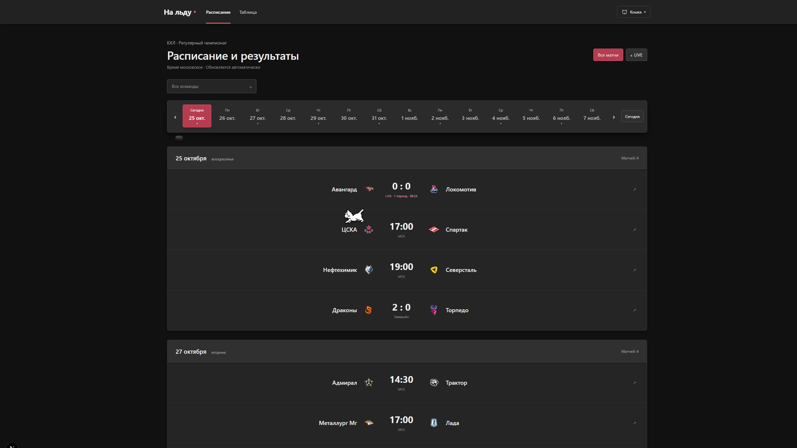
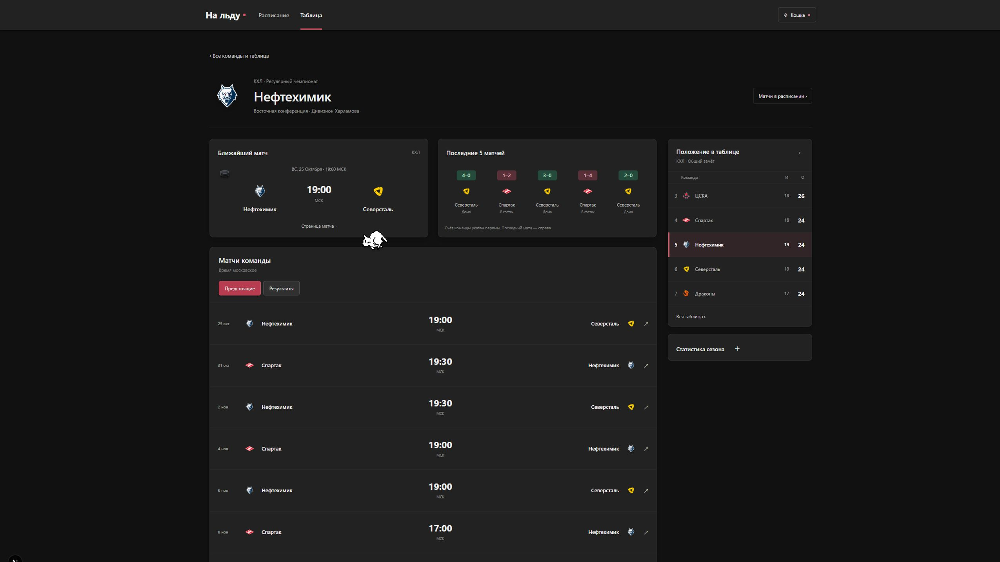
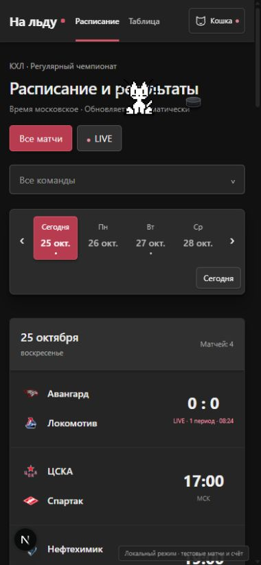

# Approved Material UI in the application

The approved prototype is now implemented in the actual Next.js routes: `/`, `/standings`, `/team/[id]`, and `/game/[id]`.

## Verification — 25 October 2026

- `npm test`: 57 passing tests, including 16 companion behavior/cleanup checks and preserved match metadata coverage.
- `npx tsc --noEmit`: passed.
- `npm run lint`: no errors; five existing warnings in the worker.
- `node dev/smoke-local-demo.mjs http://127.0.0.1:5190`: passed pages, APIs, all-status/upcoming/past queries, distinct months, team filters and missing routes.
- `npm run build`: production compilation and TypeScript passed; page-data collection fails because this environment has no DATABASE_URL. The development fixture guard remains disabled in production.
- Browser: 390×844 and 2560×1440; keyboard team search/selection, crossing October/November, direct team/match navigation, standings grouping, cat hide/show/manual goal. Exactly one cat actor persists across route changes.

These screenshots use the existing opt-in local demo adapter. Production routes retain Prisma/KHL data; no prototype fixtures or UI-kit dependencies are shipped.

## Preview

Run `npm run dev:demo -- --port 5190` for an explicitly labelled database-free local preview. Run `npm run dev` with the normal database configuration for real data.

The upstream delivery is kotyangensss/khl-stats PR #7. Its source branch remains in fantom2513/khl-stats because the current account has read-only access to upstream. No new fork-only PR is needed.

The cat uses the MIT-licensed oneko sprite in `public/images/oneko.gif`; the license is retained alongside it. The goal control previews animation only and never changes a match score.
