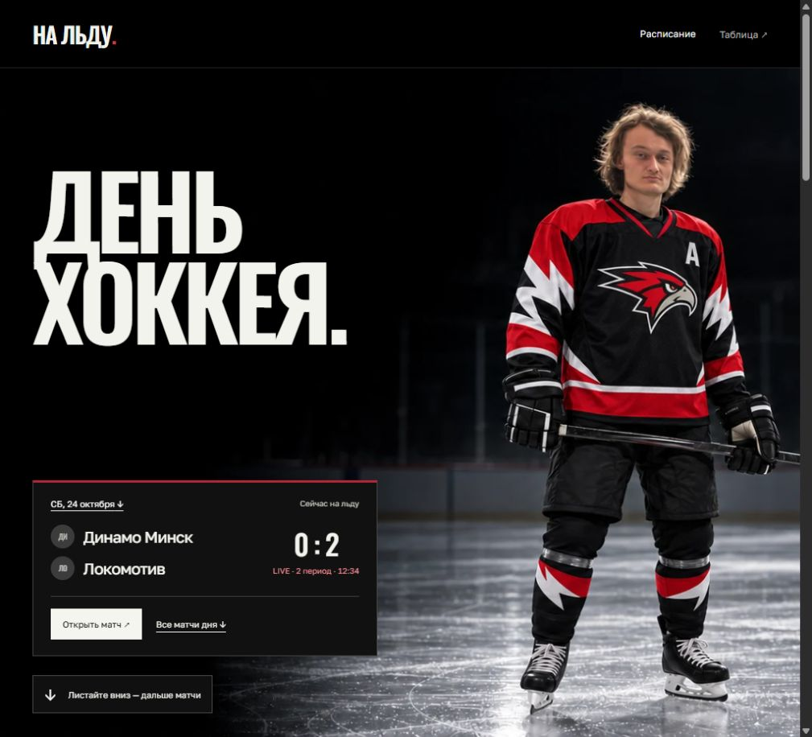
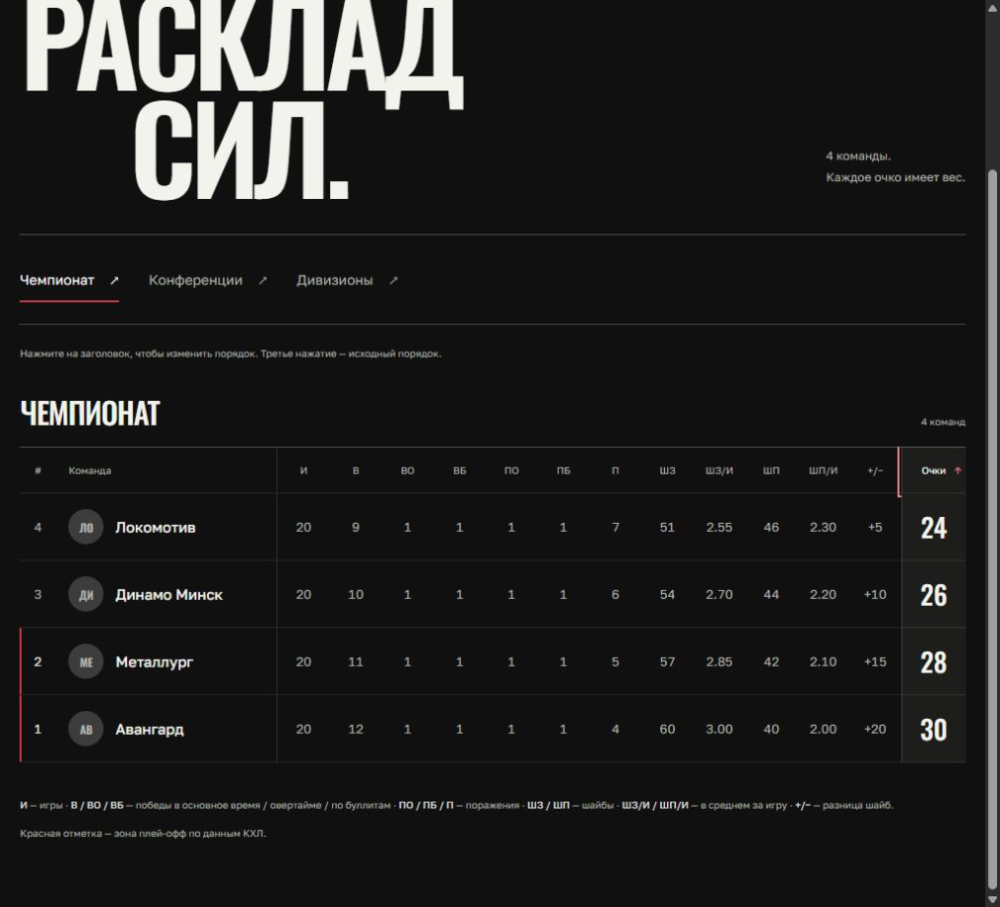
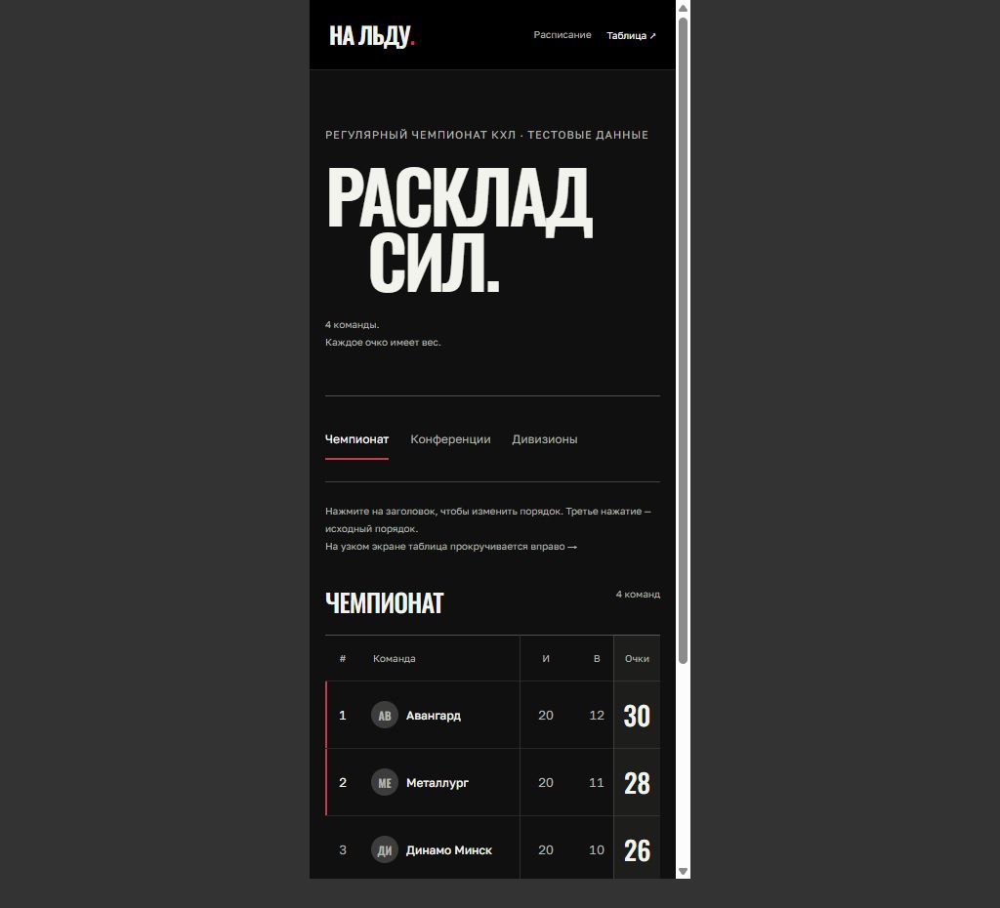

# Redesign verification

Screenshots show the actual React components with explicit test fixtures, not production data.

- `npm test`: 19 passing checks. Sort cycles, stable source ranks, averages/zero games, grouping, featured-game selection, clamped motion progress, scheduled/live/finished/unknown scores, shootouts, intermission status and upcoming team ranks.
- `npx tsc --noEmit`: passes.
- `npm run lint`: no errors; six existing warnings in untouched game/worker files.
- `npm run build`: compiles and type-checks, then fails collecting `/team/[id]` data because this checkout has no `DATABASE_URL`. A complete build and database-backed route smoke test are still required in the configured deployment environment.
- Browser at 1024px: featured link, calendar anchors, complete headline exit, intro internal scroll stays zero, team search/select/reset, results, empty day, all 15 table columns, keyboard sorting and source-order reset, two conferences and four divisions.
- Points header and numeric cell centre both measured 955.71875px at the desktop test viewport; table scroll/content widths both 968px.
- Browser iframe at 390px: mobile hero framing and readable featured card; standings scrolling remains inside its container with pinned name/rank/points. Fixed an initial grid minimum-width overflow during this check.
- Reduced-motion fallback and listener/observer cleanup inspected in code; OS preference switching was not exercised in the browser.
- Two independent review axes (standards/spec) found live status and team rank omissions. Both were reproduced with failing tests in a separate RED commit, then fixed; both reviewers confirmed resolution.

Reproduce the isolated UI preview without database access:

```powershell
node tests/ui-preview/build.mjs <absolute-output-directory>
```

Serve that directory using an approved local server. Open `ui-preview.html`, `ui-preview.html?view=standings`, `ui-preview.html?empty=1` and `ui-mobile.html`. The harness replaces Next navigation/image adapters and API responses only inside the test bundle. Production imports no fixtures. It does not validate Next routing, database queries or real API refresh end to end.




